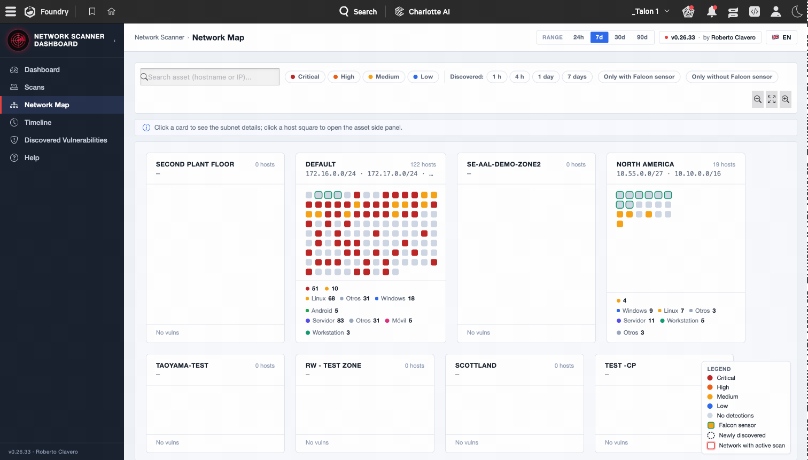
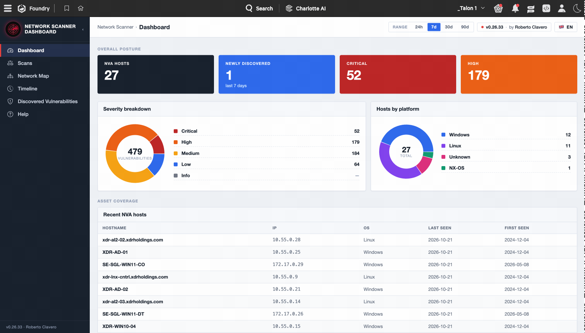
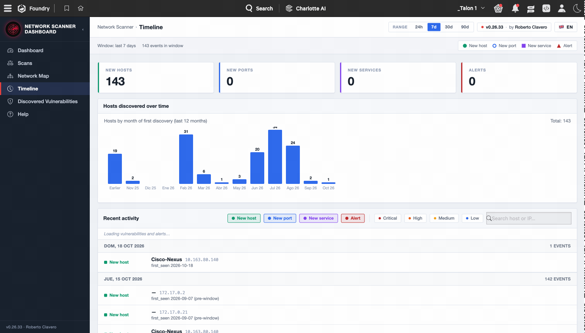
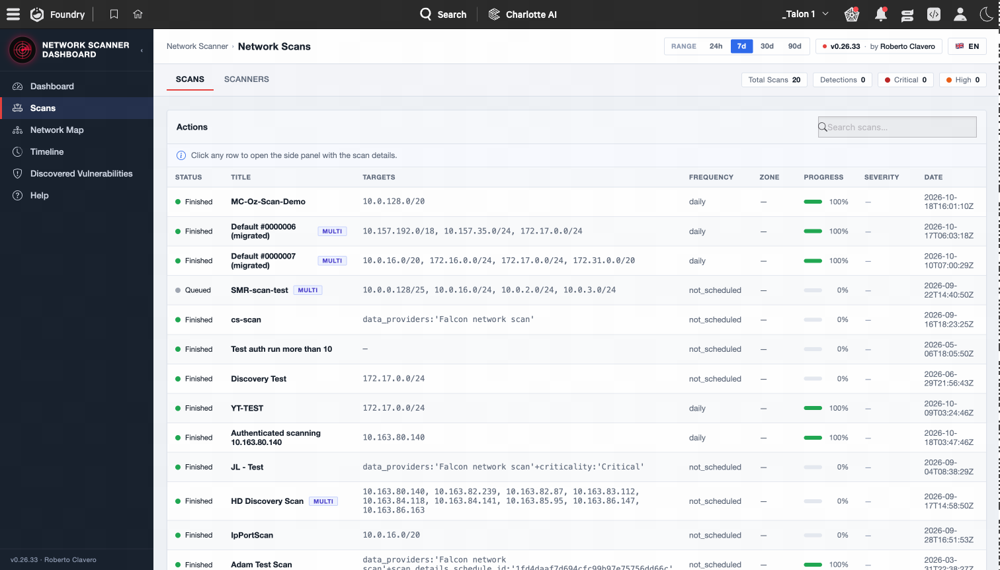

# Network Vulnerability Assesment Dashboard

<p align="center">
  
</p>

<p align="center">
  <strong>Unified monthly vulnerability-management dashboard for CrowdStrike Falcon</strong>
</p>

<p align="center">
  <a href="#features"></a>
  
  
</p>

---

## 📖 Overview

**Network Vulnerability Assesment Dashboard** is a [Falcon Foundry](https://www.crowdstrike.com/platform/falcon-foundry/) application that unifies, in a single view, all the exposure-management and vulnerability information available on the CrowdStrike Falcon platform:

- 🔭 **Falcon Exposure Management (FEM)** — external and internal assets
- 🛰️ **Falcon Network Vulnerability Assessment (NVA / Network Scanner)** — network scans, scanners (appliances), networks/zones, and detections
- 🎯 **Falcon Spotlight** — vulnerabilities on managed hosts
- 🧭 **Falcon Discover** — asset inventory (managed/unmanaged)
- 🚨 **Falcon Alerts v2** — unified alerts correlated with hosts
- 🔎 **Falcon NG-SIEM / LogScale** — on-demand telemetry searches

Designed for VM/SecOps teams that need a **consolidated monthly view** without jumping between consoles: network map, discovery timeline, executive dashboard, scans listing, and vulnerability detail — all filterable by time range (24 h, 7 d, 30 d, 90 d).

## 📸 Screenshots

### Interactive network map
Ant-colony / isometric visualization of subnets, zones, and assets discovered by the Network Scanner.

<p align="center"></p>

### Executive dashboard
Monthly summary with exposure KPIs, aggregated severity, and scanner activity.

<p align="center"></p>

### Discovery timeline
Asset-discovery histogram and correlated activity feed.

<p align="center"></p>

### Scans view
Scans / scan-runs listing with per-appliance detail and status filters.

<p align="center"></p>

## ✨ Features

- **Network map** with two layouts: *ant-colony* (force-directed) and *isometric*.
- **Timeline** with discovery histogram and per-host event drawer.
- **Dashboard** with severity KPIs, top CVEs, and source breakdown (NVA / Spotlight / FEM).
- **Scans view** with scan-run detail and detection correlation.
- **Discovered-vulnerabilities view** with search, severity filters, and detail drawer.
- **Configurable time ranges** (24 h / 7 d / 30 d / 90 d) persisted in localStorage.
- **i18n** ready for multiple languages (EN/ES).
- **Demo-data fallback** with a clearly labelled banner when live data is unavailable.

## 📦 Repository contents

```
.
├── dist/
│   └── network-vulnerability-assesment-dashboard-v0.26.33.tar.gz   ← Packaged app ready to upload to Foundry
├── docs/
│   ├── radar-logo.png
│   └── screenshots/
└── README.md
```

> ℹ️ This repository ships **only the packaged bundle** (Foundry export). Development source code is not published here.

## 🚀 Installation

### Prerequisites

- A CrowdStrike Falcon tenant with **Falcon Foundry** enabled.
- Administrator permissions to install apps from the *App Catalog*.
- Enabled API scopes:
  - `devices:read`
  - `alerts:read`
  - `assets:read` *(used by Discover and FEM)*
  - `spotlight-vulnerabilities:read`
  - `network-vulnerability-assessment:read`
  - `humio-auth-proxy:read`

### Steps

1. Download `dist/network-vulnerability-assesment-dashboard-v0.26.33.tar.gz` from this repository.
2. In the Falcon console, open **Foundry → App Manager → Import app**.
3. Select the downloaded `.tar.gz` and confirm the import.
4. When the import completes, Foundry will launch the credential wizard for each API integration — provide an API Client with the scopes listed above.
5. **Deploy** and **Release** the app from App Manager.
6. The app will appear in the Falcon launcher.

> 💡 When imported into a different tenant, Foundry **regenerates the internal IDs** (`app_id`, `page_id`, `api_integration_id`). The values present in `manifest.yml` inside the tar.gz are the original references and do not affect the new installation.

## 🧰 Tech stack

- **Frontend**: React 18 + Vite, [Shoelace Design System](https://shoelace.style/) with Falcon theme
- **SDK**: [Foundry-JS](https://developer.crowdstrike.com/foundry) for OAuth2 and Falcon API calls
- **Remote state**: TanStack Query (polling + per-resource TTL cache)
- **i18n**: react-intl

## 📝 Changelog highlights

Recent versions include:

- **v0.26.33** — Network map improvements (refined zoom/pan), NG-SIEM query optimization.
- **v0.26.26** — New map layout (`ant-colony` v2) with discovery animation.
- **v0.26.16** — Timeline with histogram and event drawer.
- **v0.26.0** — Dashboard rewrite with collapsible sections.
- **v0.25.x** — First Spotlight support + demo-data banner.

## 🔐 Security

If you find a vulnerability in the application, please **do not open a public issue** — contact the author directly.

This application is a **community/personal** development and is not an official CrowdStrike product.

## 📄 License

Distributed under the [MIT](LICENSE) license.

CrowdStrike®, Falcon®, and related product names are registered trademarks of CrowdStrike, Inc. This project is independent and is not officially endorsed by CrowdStrike.

## 👤 Author

**Roberto Clavero**

---

<p align="center"><sub>Built with ❤️ for the Falcon Foundry community.</sub></p>
