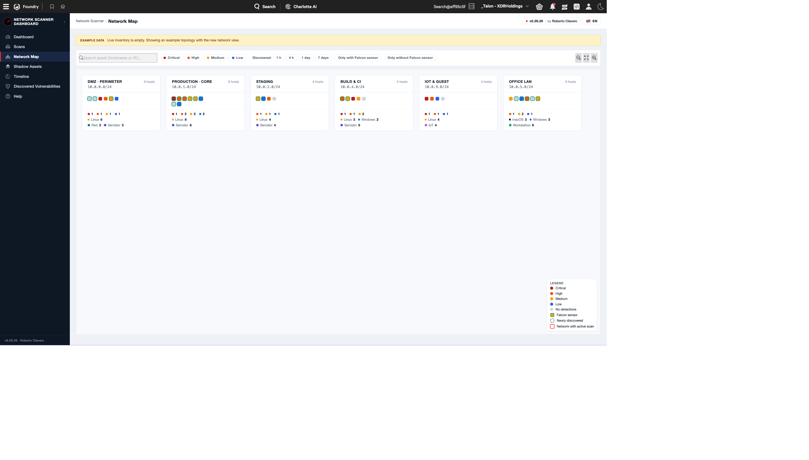
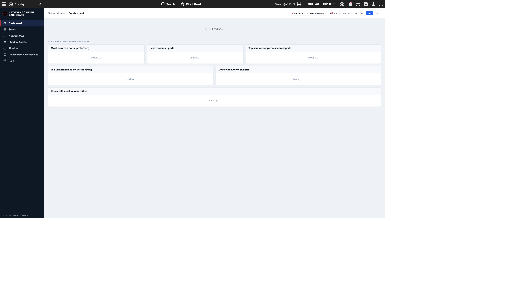
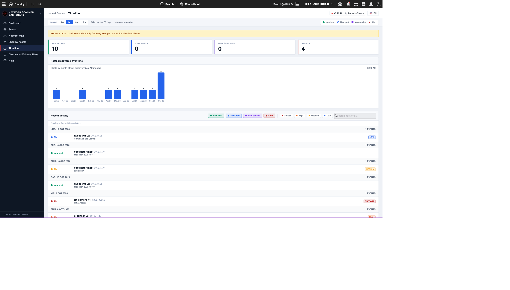
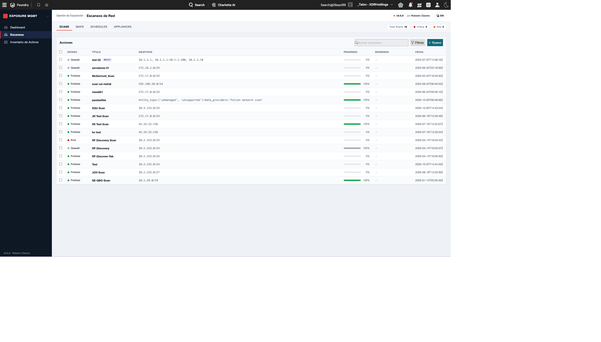

# Network Vulnerability Assesment Dashboard

<p align="center">
  
</p>

<p align="center">
  <strong>Dashboard unificado de gestión mensual de vulnerabilidades para CrowdStrike Falcon</strong>
</p>

<p align="center">
  <a href="#características"></a>
  
  
</p>

---

## 📖 Descripción

**Exposure Management Dashboard** es una aplicación de [Falcon Foundry](https://www.crowdstrike.com/platform/falcon-foundry/) que unifica en una sola vista toda la información de gestión de exposición y vulnerabilidades disponible en la plataforma CrowdStrike Falcon:

- 🔭 **Falcon Exposure Management (FEM)** — activos externos e internos
- 🛰️ **Falcon Network Vulnerability Assessment (NVA / Network Scanner)** — escaneos de red, escáneres (appliances), redes/zonas y detecciones
- 🎯 **Falcon Spotlight** — vulnerabilidades sobre hosts gestionados
- 🧭 **Falcon Discover** — inventario de activos (managed/unmanaged)
- 🚨 **Falcon Alerts v2** — alertas unificadas correlacionadas con hosts
- 🔎 **Falcon NG-SIEM / LogScale** — búsquedas de telemetría a demanda

Pensada para equipos de VM/SecOps que necesitan una **vista mensual consolidada** sin tener que saltar entre consolas: mapa de red, timeline de descubrimiento, dashboard ejecutivo, listado de escaneos y detalle de vulnerabilidades, todo filtrable por rango temporal (24 h, 7 d, 30 d, 90 d).

## 📸 Capturas

### Mapa de red interactivo
Visualización ant-colony/isométrica de subredes, zonas y activos descubiertos por el Network Scanner.

<p align="center"></p>

### Dashboard ejecutivo
Resumen mensual con KPIs de exposición, severidad agregada y actividad del escáner.

<p align="center"></p>

### Timeline de descubrimiento
Histograma de descubrimiento de activos y feed de actividad correlacionado.

<p align="center"></p>

### Vista de escaneos
Listado de scans/scan-runs con detalle por appliance y filtros por estado.

<p align="center"></p>

## ✨ Características

- **Mapa de red** con dos layouts: *ant-colony* (fuerza-dirigido) e *isométrico*.
- **Timeline** con histograma de descubrimiento y drawer de evento por host.
- **Dashboard** con KPIs por severidad, top CVEs y breakdown por fuente (NVA / Spotlight / FEM).
- **Vista de escaneos** con detalle de scan-runs y correlación de detecciones.
- **Vista de vulnerabilidades descubiertas** con búsqueda, filtros por severidad y drawer de detalle.
- **Rangos temporales configurables** (24 h / 7 d / 30 d / 90 d) persistidos en localStorage.
- **i18n** preparado para múltiples idiomas (EN/ES).
- **Fallback a datos de demo** con banner claramente etiquetado cuando no hay datos reales.

## 📦 Contenido del repositorio

```
.
├── dist/
│   └── exposure-mgmt-dashboard-v0.26.33.tar.gz   ← App empaquetada lista para subir a Foundry
├── docs/
│   ├── radar-logo.png
│   └── screenshots/
└── README.md
```

> ℹ️ Este repositorio distribuye **únicamente el bundle empaquetado** de la aplicación (export de Foundry). El código fuente de desarrollo no está publicado aquí.

## 🚀 Instalación

### Requisitos previos

- Tenant de CrowdStrike Falcon con **Falcon Foundry** habilitado.
- Permisos de administrador para instalar apps desde el *App Catalog*.
- Alcances (scopes) de API habilitados:
  - `devices:read`
  - `alerts:read`
  - `assets:read` *(usado por Discover y FEM)*
  - `spotlight-vulnerabilities:read`
  - `network-vulnerability-assessment:read`
  - `humio-auth-proxy:read`

### Pasos

1. Descarga `dist/exposure-mgmt-dashboard-v0.26.33.tar.gz` desde este repositorio.
2. En la consola de Falcon, abre **Foundry → App Manager → Import app**.
3. Selecciona el `.tar.gz` descargado y confirma la importación.
4. Cuando la importación termine, Foundry lanzará el asistente de credenciales por cada integración API — proporciona un API Client con los scopes anteriores.
5. Despliega (`Deploy`) y publica (`Release`) la app desde el App Manager.
6. La app aparecerá en el launcher de Falcon.

> 💡 Al importar en un tenant distinto, Foundry **regenera los IDs internos** (`app_id`, `page_id`, `api_integration_id`). Los valores presentes en el `manifest.yml` dentro del tar.gz son referencias originales que no afectan a la nueva instalación.

## 🧰 Stack técnico

- **Frontend**: React 18 + Vite, [Shoelace Design System](https://shoelace.style/) con tema Falcon
- **SDK**: [Foundry-JS](https://developer.crowdstrike.com/foundry) para autenticación OAuth2 y llamadas a Falcon API
- **Estado remoto**: TanStack Query (polling + caché con TTL por tipo de recurso)
- **i18n**: react-intl

## 📝 Changelog destacado

Las versiones recientes incluyen:

- **v0.26.33** — Mejoras en el mapa de red (zoom/pan refinado), optimización de queries NG-SIEM.
- **v0.26.26** — Nuevo layout de mapa (`ant-colony` v2) con animación de descubrimiento.
- **v0.26.16** — Timeline con histograma y drawer de evento.
- **v0.26.0** — Reescritura del dashboard con secciones colapsables.
- **v0.25.x** — Primer soporte Spotlight + banner de datos demo.

## 🔐 Seguridad

Si descubres una vulnerabilidad en la aplicación, por favor **no abras un issue público** — contacta directamente al autor.

Esta aplicación es un desarrollo **community/personal** y no es un producto oficial de CrowdStrike.

## 📄 Licencia

Distribuido bajo licencia [MIT](LICENSE).

CrowdStrike®, Falcon® y los nombres de productos relacionados son marcas registradas de CrowdStrike, Inc. Este proyecto es independiente y no está respaldado oficialmente por CrowdStrike.

## 👤 Autor

**Roberto Clavero**

---

<p align="center"><sub>Hecho con ❤️ para la comunidad de Falcon Foundry.</sub></p>
