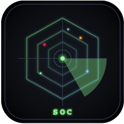
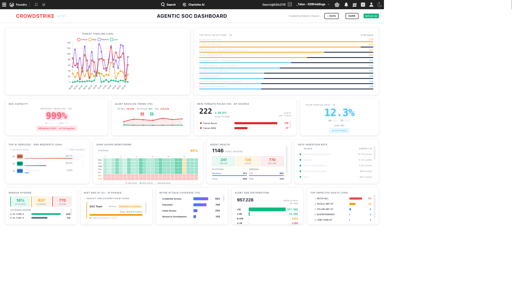

# Agentic SOC Oversight Dashboard

<p align="center">
  
</p>

<p align="center">
  <strong>Videowall en tiempo real para equipos SOC construido sobre CrowdStrike Falcon Foundry</strong>
</p>

<p align="center">
  <a href="https://www.crowdstrike.com/platform/falcon-foundry/"></a>
  
  
</p>

---

## 📖 Descripción

**Agentic SOC Oversight Dashboard** es una aplicación de [Falcon Foundry](https://www.crowdstrike.com/platform/falcon-foundry/) diseñada como *videowall* para SOC leads y managers. Consolida en una sola vista las métricas clave de operaciones de un SOC moderno sin tener que saltar entre consolas.

Las métricas se obtienen en vivo de la plataforma Falcon:

- 🚨 **Alerts REST API** — volumen, severidad, backlog y edad de alertas (fuente primaria)
- 💻 **Devices API** — inventario de endpoints, mix de plataformas, distribución de sensor
- 🔎 **NGSIEM / LogScale** — saved searches para ingestion rate, MITRE y agent activity
- 🤖 **Charlotte AI** — uso de créditos y top consumidores
- 🧰 **Fusion Workflows** — ejecuciones de workflows SOAR

El dashboard refresca automáticamente cada ~1 minuto. Cada widget expone un indicador de estado:

- 🟢 **Verde** — dato live del backend
- 🟡 **Amarillo** — fallback / mock (API no disponible o tenant vacío)

## 📸 Capturas

<p align="center"></p>

## ✨ Widgets (15 en total)

El dashboard se organiza en 4 filas temáticas:

| Fila | Widgets |
|------|---------|
| **1. Threat Pulse** | Threat Timeline (24H) · Top Noisy Detections (7D) |
| **2. Threat Landscape** | SOC Capacity · Alert Backlog Trend (7D) · New Threats Pulse (1H) · Alert Age Distribution |
| **3. Operational** | Top AI Services (24H) · Dark Hours Monitoring · Agent Health · CrowdStrike Data Ingestion Rate · 3rd-Party Feed Silence |
| **4. Deep Analytics** | Sensor Hygiene · NIST 800-61 v3 IR Phases · MITRE ATT&CK Coverage (7D) · Top Impacted Hosts (24H) |

Para la descripción detallada de cada widget (qué muestra, cómo leerlo, qué query lo alimenta) consulta **[docs/widget-guide.md](docs/widget-guide.md)**.

### Highlights funcionales

- **3rd-Party Feed Silence**: lista color-coded por vendor con 5 niveles de staleness (<15m / ≥15m / ≥30m / ≥1h / ≥4h), construida combinando `postAggregatesAlertsV2` sobre `source_vendors` + resolución del último `created_timestamp` por vendor.
- **MITRE ATT&CK Heatmap (7D)**: cobertura de tácticas y técnicas detectadas a partir de alertas.
- **NIST 800-61 v3 IR Phases**: tracking de actividad de analistas por fase del ciclo de respuesta.
- **Dark Hours Monitoring**: heatmap de actividad fuera de horario (día de la semana × hora).
- **Mean Time Metrics**: MTTD / MTT / MTTR calculados en LogScale.
- **Fallback a mock data** con banner y dot amarillo claramente visibles cuando una fuente falla.

## 📦 Contenido

```
soc-dashboard/
├── README.md                        ← este fichero
├── dist/
│   └── soc-dashboard_TUG_BCN.tar.gz ← export de la app para importar en Foundry
└── docs/
    ├── widget-guide.md              ← guía detallada de los 15 widgets
    ├── logo.png
    └── screenshots/
```

> ℹ️ Este repositorio distribuye **solo el bundle empaquetado** (export de Foundry). El código fuente de desarrollo no está publicado aquí.

## 🚀 Instalación

### Requisitos previos

- Tenant de CrowdStrike Falcon con **Falcon Foundry** habilitado.
- Permisos de administrador para instalar apps desde el *App Manager*.
- Alcances (scopes) de API habilitados (ya declarados en el `manifest.yml`):
  - `alerts:read`
  - `incidents:read`
  - `detects:read`
  - `devices:read`
  - `host-group:read`
  - `workflow:read`
  - `message-center:read` *(para /xdr/cases)*
  - `cases:read`
  - `discover:read`
  - `zero-trust-assessment:read`
  - `foundry-pages:read` / `foundry-pages:write`
  - `app-logs:read` / `app-logs:write`
  - `ioc:read`
  - `cspm-registration:read`

### Pasos

1. Descarga **[`dist/soc-dashboard_TUG_BCN.tar.gz`](dist/soc-dashboard_TUG_BCN.tar.gz)** desde este repositorio.
2. En la consola de Falcon, abre **Foundry → App Manager → Import app**.
3. Selecciona el `.tar.gz` y confirma la importación.
4. Al terminar, Foundry lanzará el asistente de credenciales. Proporciona un API Client con los scopes anteriores.
5. **Deploy** y **Release** la app desde el App Manager.
6. La app aparecerá en el launcher de Falcon (nombre: *SOC Dashboard*).

> 💡 Al importar en un tenant distinto, Foundry **regenera los IDs internos** (`app_id`, `page_id`, `function_id`, `saved_search_id`). Los valores presentes en el `manifest.yml` dentro del tar.gz son referencias originales que no afectan a la nueva instalación.

## 🧰 Stack técnico

- **Frontend**: React 18 + Vite, [Shoelace Design System](https://shoelace.style/), Chart.js
- **SDK**: [Foundry-JS](https://developer.crowdstrike.com/foundry) (autenticación OAuth2 y Falcon API)
- **Cloud functions**: Python (FalconPy) — `charlotte-credits-fn`, `incidents-fn`, `devices-fn`, `workflow-executions-fn`
- **Saved searches**: 18 queries LQL en LogScale/NGSIEM

## 📝 Changelog destacado

Las versiones recientes incluyen:

- **v0.7.137** — Nuevo widget *3rd-Party Feed Silence* con 5 niveles de staleness por vendor
- **v0.7.136** — Reescritura de *Data Ingestion* para agregar directamente sobre `source_vendors`
- **v0.7.134** — Separación visual de ingestion CrowdStrike vs 3rd-party
- **v0.7.65** — Mean Time to Detect/Triage/Resolve en vivo desde LogScale
- **v0.7.9** — Migración completa a Alerts REST API (267k+ alertas sobre tenant vacío de LogScale)
- **v0.6.0** — Primera versión con los 15 widgets y layout de 4 filas

## 🔐 Seguridad

Si descubres una vulnerabilidad en la aplicación, por favor **no abras un issue público** — contacta directamente al autor.

Esta aplicación es un desarrollo **community/personal** y no es un producto oficial de CrowdStrike.

## 📄 Licencia

Distribuido bajo licencia [MIT](../LICENSE).

CrowdStrike®, Falcon® y los nombres de productos relacionados son marcas registradas de CrowdStrike, Inc. Este proyecto es independiente y no está respaldado oficialmente por CrowdStrike.

## 👤 Autor

**Roberto Clavero**

---

<p align="center"><sub>Hecho con ❤️ para la comunidad de Falcon Foundry.</sub></p>
